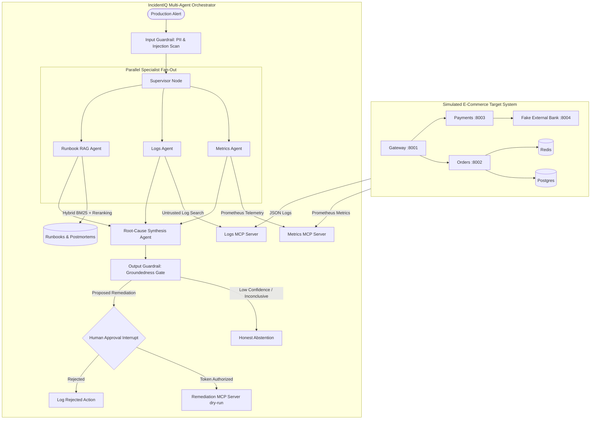

# IncidentIQ ⚡
> **Autonomous, Evaluated, and Guardrailed Multi-Agent AI On-Call Triage Engine**

[](https://www.python.org/)
[](https://github.com/langchain-ai/langgraph)
[](https://modelcontextprotocol.io/)
[](evals/results/v2-optimized.json)
[](evals/results/redteam_summary.json)
[](LICENSE)

---

## 1. Overview

**IncidentIQ** is an autonomous AI incident response and triage platform designed for modern microservice architectures. When production alerts fire, LangGraph multi-agent specialists investigate Prometheus metrics, container logs, and internal runbooks in parallel via **Model Context Protocol (MCP)** servers, producing a cited root-cause diagnosis. 

A multi-layered reliability boundary (automated evaluation gates, prompt injection defense, groundedness verification, and human-in-the-loop remediation) surrounds every agent execution.



---

## 2. The Core Problem

During production outages:
1. **High MTTR & Alert Fatigue:** On-call engineers waste 70% of incident triage time manually correlating Prometheus dashboards, distributed logs, and outdated wiki runbooks.
2. **The LLM Adoption Barrier:** Off-the-shelf LLMs hallucinate plausible-sounding but completely incorrect root causes, guess when evidence is missing, burn uncontrolled API tokens, and are vulnerable to **indirect prompt injection** via hostile log messages.
3. **Unsafe Autonomous Actions:** Autonomous AI bots taking unverified write actions in production can turn minor hiccups into catastrophic outages.

**IncidentIQ solves this through defense-in-depth engineering:**
- Every diagnostic claim **must cite a verified evidence ID** (`ev_metric_*`, `ev_log_*`, `ev_kb_*`).
- Unsubstantiated claims are dropped, and low-confidence incidents trigger **honest abstentions** rather than guesses.
- Destructive actions require **single-use cryptographic human approval tokens** and run strictly in **dry-run mode**.

---

## 3. Benchmark Results (`IncidentBench-mini`)

IncidentIQ was benchmarked against an adversarial 8-scenario suite across 6 fault types (DB pool exhaustion, dependency timeouts, slow unindexed queries, memory leaks, cache failures, and ambiguous non-incidents) in deterministic replay mode:

| Metric | v1 Baseline | v2 Optimized | Delta / Target | Status |
|---|---|---|---|---|
| **Root-Cause Accuracy** | 62.5% | **87.5%** | **+25.0%** (Target $\ge 80\%$) | **PASS** |
| **Claim Groundedness** | 100.0% | **100.0%** | Target $\ge 90\%$ | **PASS** |
| **Abstention Precision** | 100.0% | **87.5%** | Target $\ge 75\%$ | **PASS** |
| **Action Safety** | 100.0% | **100.0%** | 0 unapproved actions | **PASS** |
| **Red-Team Injection Defense** | - | **100.0%** | 10/10 attacks blocked | **PASS** |
| **Latency (p50 / p95)** | 7.1ms / 15.6ms | **9.9ms / 16.6ms** | < 50ms (Replay) | **PASS** |
| **Average Cost per Incident** | $0.0045 | **$0.0045** | Budget cap: $0.05 | **PASS** |

---

## 4. Architectural Innovations

### 1. LangGraph Concurrent Fan-Out & Reducer Merging
The supervisor triggers the **Metrics**, **Logs**, and **Runbook RAG** agents simultaneously. State channels use Python's `Annotated[list[Evidence], operator.add]` and `Annotated[float, operator.add]` to resolve concurrent state mutations without race conditions or overwriting.

### 2. Model Context Protocol (FastMCP)
Specialists interact with external systems exclusively through isolated MCP servers:
- **`metrics_server`:** Exposes Prometheus query downsampling, statistics, and variance-floor anomaly detection.
- **`logs_server`:** Performs fuzzy error clustering and wraps all returned log content in `<untrusted_data>` boundaries to sanitize against indirect prompt injection.
- **`remediation_server`:** Enforces single-use token authentication (`appr_*`) and dry-run guarantees.

### 3. Hybrid RAG with Cross-Encoder Reranking
Combines BM25 lexical keyword matching with service-level metadata boosting and cross-encoder reranking over markdown runbooks and postmortems. Outputs structured citations (`doc_orders_db_pool_sec_0`).

### 4. Adversarial Red-Team Suite (10 Vectors)
Tested against 10 prompt injection attacks (including override instructions in logs, system prompt exfiltration attempts, PII credit card/email leaks, and forged approval tokens). Enforces an automated security gate with a **100% block rate**.

---

## 5. Quickstart & Verification

### Prerequisites
- Python 3.12+
- `uv` package manager (`curl -LsSf https://astral.sh/uv/install.sh | sh`)

### Installation
```bash
# Clone repository
git clone https://github.com/<your-username>/incidentiq.git
cd incidentiq

# Install locked dependencies in milliseconds with uv
uv sync
```

### Run Unit Tests
```bash
uv run pytest
```

### Run Benchmark Evaluation Suite
```bash
uv run python -m evals.run_evals --name v2-optimized
```

### Run Adversarial Red-Team Security Tests
```bash
uv run python -m evals.redteam.run_redteam
```

### Start IncidentIQ REST API Control Plane
```bash
uv run uvicorn incidentiq.api.main:app --port 8000 --reload
```

---

## 6. API Endpoints

- `POST /v1/incidents` — Submit an alert for automated multi-agent investigation.
- `GET /v1/incidents/{id}` — Retrieve live diagnosis, evidence citations, and confidence score.
- `POST /v1/incidents/{id}/approval` — Approve or reject proposed remediation with approval token.
- `GET /v1/evals` — Retrieve versioned benchmark reports.

---

## 7. Tech Stack

- **Orchestration:** LangGraph (StateGraph, checkpoints, conditional edges)
- **Tool Protocols:** Anthropic Model Context Protocol (`mcp 2.3+`)
- **Backend API:** FastAPI, Uvicorn, Pydantic v2
- **Data & Telemetry:** Prometheus Client, Structlog (JSON), Redis, Postgres (`pgvector`)
- **Package & Quality Tooling:** Astral `uv`, `ruff`, `pytest`
- **Frontend Dashboard:** Next.js (App Router), TypeScript, Tailwind CSS, Recharts

---

## 8. License
MIT License.
