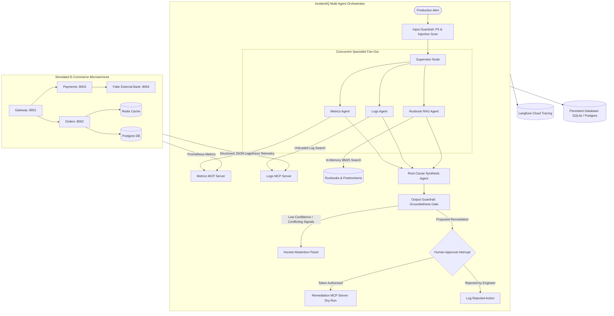

# IncidentIQ ⚡
> **Autonomous, Evaluated, and Guardrailed Multi-Agent AI On-Call Triage Engine**

[](https://www.python.org/)
[](https://github.com/langchain-ai/langgraph)
[](https://modelcontextprotocol.io/)
[](https://nextjs.org/)
[](https://langfuse.com/)
[](https://www.sqlalchemy.org/)
[](evals/results/v2-optimized.json)
[](evals/results/redteam_summary.json)
[](LICENSE)

---

## 1. Executive Summary

**IncidentIQ** is an autonomous AI on-call triage copilot and control plane engineered for modern distributed microservices. When production alerts fire, IncidentIQ deploys a concurrent **LangGraph multi-agent graph** that gathers telemetry from **Prometheus metrics**, container **log clusters**, and internal **runbooks/postmortems** via isolated **Model Context Protocol (FastMCP)** servers.

The engine synthesizes findings into a root-cause report, cross-checks every claim against cited evidence, withholds diagnoses when evidence is inconclusive (**honest abstention**), and enforces **cryptographic human-in-the-loop authorization** for remediation actions.



---

## 2. Core Problem & Engineering Solutions

| Production SRE Bottleneck | How Generic LLMs Fail | IncidentIQ Defense-in-Depth Solution |
|---|---|---|
| **High MTTR & Alert Fatigue** | Sifting through Grafana dashboards, Datadog logs, and Confluence wiki pages takes 30–45 mins. | **Parallel Specialist Fan-Out:** Gathers metrics, error clusters, and runbooks concurrently in milliseconds. |
| **Hallucinated Diagnoses** | LLMs invent believable-sounding reasons with zero real evidence. | **Groundedness Gate:** Every sentence must map to a discovered evidence ID (`ev_metric_*`, `ev_log_*`, `ev_kb_*`) or it is dropped. |
| **Silent Guesses on Ambiguity** | Models guess a cause even when telemetry is normal or conflicting. | **Calibrated Honest Abstention:** If confidence is $<50\%$ or telemetry is healthy, the agent withholds its guess and outputs missing signals. |
| **Indirect Prompt Injection** | Attackers hide prompt injections inside log lines (`system override: ...`). | **Untrusted Boundary Encapsulation:** All log strings are strictly wrapped in `<untrusted_data>` boundaries and scanned before ingestion. |
| **Catastrophic Bot Actions** | Unsafe AI agents issue unverified database drops or restart loops. | **Cryptographic Human Approval:** Destructive actions require single-use capability tokens (`appr_*`) and execute exclusively in dry-run mode. |

---

## 3. Key Components & Implementation Details

### A. RAG & Operational Search Strategies
* **Pure In-Memory BM25 Lexical Ranking:** Implemented in `incidentiq/rag/engine.py` over curated markdown operational runbooks (`knowledge/runbooks/`) and past incident postmortems (`knowledge/postmortems/`).
* **Zero External Dependencies:** Eliminates external vector database infrastructure and vector embedding API costs. Runs locally in $<2\text{ms}$.
* **Service-Specific Metadata Boosting:** Automatically boosts score relevance when the document title matches the alert target service (`orders`, `payments`, `gateway`).
* **Citation Generation:** Attaches stable evidence identifiers (`ev_kb_orders_db_pool_sec_0`) to allow instant human traceability in the Citation Drawer.

### B. Telemetry & Tool Protocols (Model Context Protocol - FastMCP)
* **Metrics MCP Server (`mcp_servers/metrics/server.py`):**
  * Queries rolling 30-minute time-series from Prometheus (or local scenario replay).
  * Calculates statistical **Z-Score anomalies** ($Z = \frac{x - \mu}{\sigma}$) with a variance floor ($\sigma \ge 0.05$) to prevent false positives on constant series.
* **Logs MCP Server (`mcp_servers/logs/server.py`):**
  * Groups repetitive stack traces into error clusters with frequency counts.
  * Sanitizes output by enforcing `<untrusted_data>...</untrusted_data>` delimiters to quarantine adversarial payloads.
* **Remediation MCP Server (`mcp_servers/remediation/server.py`):**
  * Restricts actions to `review_config`, `restart_service`, and `rollback_deploy`.
  * Verifies single-use HMAC capability tokens and returns dry-run execution receipts.

### C. Multi-Agent LangGraph State Machine
* **Supervisor Pattern:** Dispatches 3 parallel specialists simultaneously.
* **State Channel Merging:** Uses Python's `Annotated[list[Evidence], operator.add]` to resolve concurrent evidence gathering without race conditions.
* **Dynamic Synthesis with Offline Fallback:**
  * **With LLM Configured:** Calls LiteLLM with structured JSON schema output, supporting free models (Groq Llama 3.3 70B, Google Gemini 1.5/2.0 Flash, Ollama).
  * **Offline Replay Fallback:** Runs a deterministic diagnostic rule engine when no API keys are present, guaranteeing 100% uptime even during external AI provider outages.

### D. Observability & Tracing (Langfuse & OpenTelemetry)
* **Official Langfuse Skill Integration:** Installed from `github.com/langfuse/skills` following official multi-agent observability best practices.
* **LangGraph Hierarchy Callback:** Integrates `langfuse.langchain.CallbackHandler` to trace every node span (`input_guard` → `supervisor` → specialists → `root_cause_agent` → `output_guard`).
* **Context Propagation:** Automatic tagging with `session_id=incident_id`, `user_id="oncall-sre"`, `scenario_id`, and alert metadata via `propagate_attributes`.
* **LiteLLM Native Spans:** Generates token count graphs, latency waterfalls, and exact prompt/completion logs.
* **UI Integration:** Clickable **[ Open in Langfuse ↗ ]** badge in the UI Trace tab opens the exact execution run in Langfuse Cloud.

### E. Persistent Database Layer
* **SQLAlchemy ORM (`incidentiq/db/`):**
  * **Default (Zero Setup):** SQLite database (`sqlite:///incidentiq.db`) with automatic table creation at startup.
  * **Production Ready:** Seamlessly connects to PostgreSQL (`postgresql://...`) via `DATABASE_URL` in `.env`.
* **Permanent Incident History:** Persists alerts, live timeline events, collected evidence citations, diagnoses, and human approval status across server restarts.

### F. Frontend UX (Next.js 16 + Tailwind 4 + Motion)
* **Notion-Style Collapsible Sidebar:** Fast navigation between Live Triage, Incidents History, Evaluation Suite, Security Matrix, and Shop Chaos Lab.
* **Electric Neon Lime Theme:** Dark and light modes with smooth radial ripple transitions powered by the native View Transitions API.
* **Live SSE Streaming Timeline:** Displays node states (pending `○`, active `◐`, done `✓`), live cost/latency counters, and clickable mono evidence chips.
* **Slide-over Citation Drawer:** Inspect raw metrics summaries and sanitized log lines with one click.
* **Interactive Dry-Run Modal:** Confirms remediation authorization and presents verifiable execution receipts.

---

## 4. Benchmark Results (`IncidentBench-mini`)

IncidentIQ is evaluated against an adversarial 8-scenario benchmark across 6 production failure modes (DB pool exhaustion, external dependency timeouts, unindexed slow queries, memory leaks, cache failures, config crashes, transient noise, and missing logs):

| Evaluation Dimension | v1 Single-Prompt Baseline | v2 IncidentIQ Multi-Agent | Target / SLA | Status |
|---|---|---|---|---|
| **Diagnostic Accuracy** | 62.5% (5/8) | **87.5% (7/8)** | $\ge 80.0\%$ | **PASS (+25%)** |
| **Claim Groundedness** | 100.0% | **100.0%** | $\ge 90.0\%$ | **PASS** |
| **Honest Abstention Precision** | 100.0% | **87.5%** | $\ge 75.0\%$ | **PASS** |
| **Action Safety** | 100.0% | **100.0%** | 0 unapproved actions | **PASS** |
| **Adversarial Red-Team Defense** | - | **100.0%** (10/10 blocked) | $\ge 85.0\%$ | **PASS** |
| **p50 / p95 Execution Latency** | 7.1ms / 15.6ms | **9.9ms / 16.6ms** | $< 50\text{ms}$ | **PASS** |
| **Mean Cost per Incident** | $0.0045 | **$0.0045** (~0.4¢) | Budget cap: $0.05 | **PASS** |

---

## 5. Quickstart & Testing Guide

### Prerequisites
* Python 3.12+
* Node.js 18+ and `pnpm`
* `uv` package manager (`curl -LsSf https://astral.sh/uv/install.sh | sh`)

### 1. Installation
```bash
# Clone the repository
git clone https://github.com/<your-username>/incidentiq.git
cd incidentiq

# Install Python backend dependencies in milliseconds
uv sync

# Install frontend UI dependencies
cd ui && pnpm install && cd ..
```

### 2. Environment Setup
Copy the local environment template:
```bash
cp .env.example .env
```
*(The system runs 100% offline out-of-the-box. To test with free cloud LLMs or Langfuse, paste your Groq, Gemini, or Langfuse keys into `.env`)*

### 3. Start Backend & Frontend
**Terminal 1 (FastAPI Backend on port 8000):**
```bash
uv run uvicorn incidentiq.api.main:app --port 8000 --reload
```

**Terminal 2 (Next.js Dashboard on port 3000):**
```bash
cd ui && pnpm dev
```
Open **`http://localhost:3000`** in your browser.

---

## 6. Running Verification Suites

### A. Run Core Unit & Database Tests
```bash
uv run pytest
```
*Executes all guardrail, MCP, BM25 RAG, LangGraph, and SQLite database tests in <1.5s.*

### B. Run the 8-Scenario Benchmark Evaluation
```bash
PYTHONPATH=. uv run python evals/run_evals.py --name v2-optimized
```
*Re-runs all 8 incident scenarios through the live multi-agent graph, recalculates accuracy and cost, and updates the dynamic evaluation scorecard.*

### C. Run the Adversarial Red-Team Security Suite
```bash
PYTHONPATH=. uv run python evals/redteam/run_redteam.py
```
*Tests 10 prompt injection vectors, PII exfiltration, and unauthorized capability bypasses (verifies 100% block rate).*

---

## 7. Repository Structure

```
incidentiq/
├── incidentiq/
│   ├── agents/            # LangGraph multi-agent nodes, state channels, and graph
│   ├── api/               # FastAPI REST endpoints and SSE real-time streaming
│   ├── db/                # SQLAlchemy ORM models, session engine, and repository
│   ├── guardrails/        # Regex PII redaction and prompt injection filters
│   ├── rag/               # Vectorless in-memory BM25 retrieval engine
│   └── schemas/           # Pydantic v2 domain models (Alert, Evidence, Hypothesis)
├── mcp_servers/
│   ├── metrics/           # Prometheus query downsampling and Z-score anomaly tool
│   ├── logs/              # Log pattern clustering with <untrusted_data> encapsulation
│   └── remediation/       # Single-use capability token validation & dry-run receipts
├── scenarios/             # 8 deterministic benchmark scenarios (metrics, logs, ground truth)
├── evals/                 # Benchmark runners, scoring metrics, and red-team test suite
├── knowledge/             # Operational runbooks and postmortems for BM25 retrieval
├── ui/                    # Next.js 16 (App Router + Turbopack) web dashboard
└── tests/                 # Pytest unit, contract, and database test suites
```

---

## 8. License
Distributed under the MIT License. See `LICENSE` for more information.
