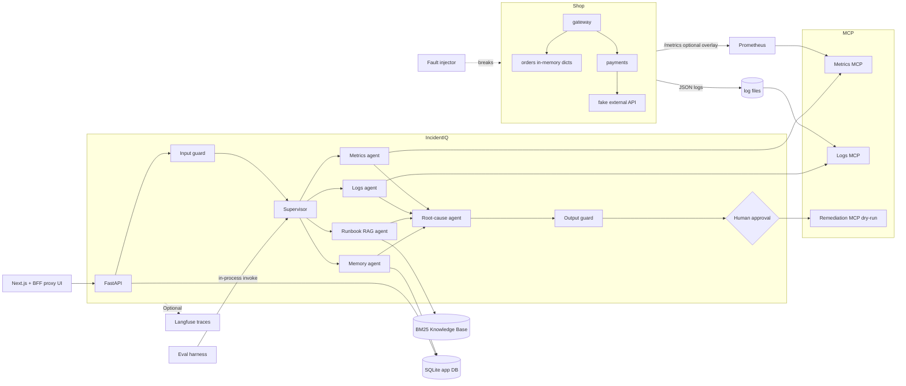
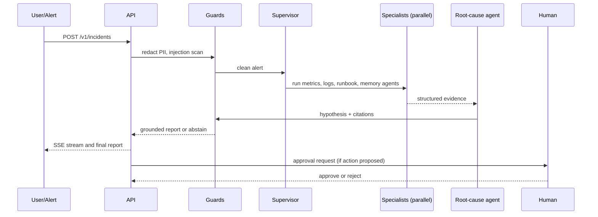

# System Architecture: IncidentIQ

## 1. Overview

Two systems run side by side:

1. **Shop (target system):** a small e-commerce backend that produces real metrics and logs and is broken on purpose.
2. **IncidentIQ:** the investigation platform (API, agents, RAG, guardrails, evals, observability).

They connect only through Prometheus (metrics) and log files, read via MCP servers.

## 2. Component diagram

> *Note:* `evals/run_evals.py` invokes `incident_graph.invoke(...)` directly in-process rather than over HTTP `API` (so eval runs bypass FastAPI auth and rate limits). Live CLI chaos injection (`faults/injector.py`) supports `db_pool`, `slow_query`, and `dependency_timeout` (+ `reset`), while other fault types exist as recorded replay scenarios in `scenarios/`.

## 3. Incident sequence

## 4. Layers and responsibilities

| Layer | Responsibility |
|---|---|
| API (FastAPI) | Validation, static `X-API-Key` auth, IP rate limit, SSE streaming (`/stream`), SQLite persistence |
| Guardrails | Regex PII redaction, pattern injection scan, citation groundedness, prompt-leakage scan, abstention, budget |
| Orchestration (LangGraph) | State machine, parallel fan-out, DB-persisted approval state & capability tokens |
| Agents | Hybrid deterministic MCP/BM25 workers and LLM/fallback root-cause synthesis returning Pydantic outputs |
| MCP servers | Tool boundary: Pydantic validation, window/limit caps, `tool_calls` logging, `<untrusted_data>` wrapping |
| RAG | In-memory Okapi BM25 + token Jaccard + service metadata boost (`rag/engine.py`), SQLite episodic memory (`rag/memory.py`), citations |
| LLM layer | LiteLLM completion in `agents/nodes.py` with retry, deterministic rule-engine fallback, and `llm_calls` cost tracking |
| Observability | Optional Langfuse traces, `structlog` JSON logs in shop, optional Prometheus overlay scraping shop `/metrics` |
| Eval | Replay runner (`evals/run_evals.py`), rule/citation scorers, live feedback scoring (`score_live.py`), versioned JSON results, CI gate |

## 5. Run modes

| Mode | Data source | Used for |
|---|---|---|
| live | Prometheus HTTP API (via monitoring overlay) and real log files from the running shop | Demos and telemetry capture |
| replay | Frozen scenario folders (`scenarios/<id>/`) | Evals, CI, debugging (deterministic) |

Selected by `DATA_MODE=live|replay`; in `replay` mode, `scenario_id` is passed per call via `IncidentState` and MCP arguments (`SCENARIO_ID` env var serves as server fallback default).

## 6. Key design decisions

| Decision | Rationale | Trade-off |
|---|---|---|
| Real demo shop plus replay snapshots | Real telemetry shape, deterministic evals | Extra setup time |
| Custom MCP servers | Shows protocol understanding, enforces least privilege in code | More code than reusing existing servers |
| Parallel specialists + `memory_agent` | Lower latency, episodic recall across verified runs | Requires reducer-based state merging (`operator.add`) |
| Structured Pydantic outputs everywhere | Easy scoring, fewer parse errors | Prompt design effort |
| DB-persisted approval + HMAC capability token | Safe dry-run gating, survives API restarts without a LangGraph checkpointer | Resumes via API endpoint rather than mid-graph `interrupt()` replay |
| Single-worker SQLite (`WORKERS=1`) + BM25/Jaccard RAG | Zero external DB/GPU dependencies in the cost-capped demo while preserving Postgres URL translation | Single-worker concurrency; dense vector search & reranking deferred |
| LiteLLM + deterministic fallback in `nodes.py` | Offline/CI reproducibility with zero API spend when keys are absent | Dedicated router/Redis cache deferred |

## 7. Failure handling

| Failure | Behavior |
|---|---|
| LLM call fails or times out | Retries via LiteLLM (`num_retries=2`), then falls back to deterministic rule-based synthesis (`is_fallback=true`) |
| MCP tool error | Agent skips failed metric or returns empty list, continues with other tools/specialists |
| Budget or step cap exceeded | Routes to `budget_exceeded_node`, forces abstention, flags `budget_exceeded` |
| Guard flags injection | Quarantines content (`[QUARANTINED_POTENTIAL_INJECTION]`), continues safely, records `guardrail_events` |
| Approval timeout or rejection | Token expires (15m TTL) or is consumed; incident stays `awaiting_approval` or transitions to `rejected_by_human` |

## 8. Scalability notes & Planned / Future work

The system is built for demo scale (single-worker FastAPI + SQLite, a few incidents per minute).

**Planned / Future work (not implemented in v1):**
- PostgreSQL 16 + `pgvector` HNSW + `tsvector` hybrid RAG with `bge-small`/`bge-base` embeddings and `bge-reranker` cross-encoder reranking.
- Redis exact-match LLM response caching (`llm/cache.py`), rate limiting, and worker queues (Celery/Arq).
- Dedicated `incidentiq/llm/` router/cost modules and native LangGraph checkpointing / `interrupt()`.
- IncidentIQ API `/metrics` Prometheus exporter and Grafana dashboards.
- Separate network deployments for MCP servers on multi-node clusters.
