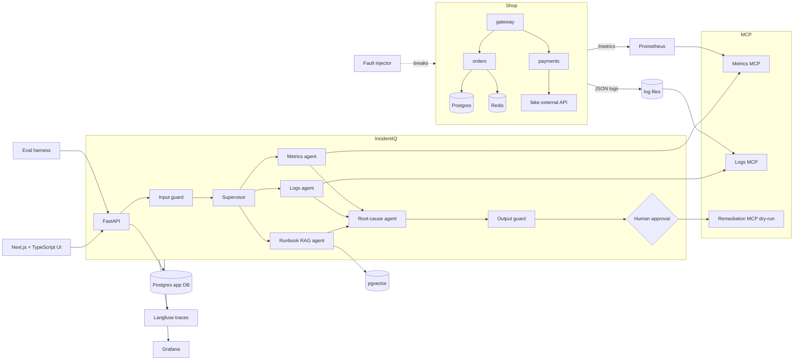
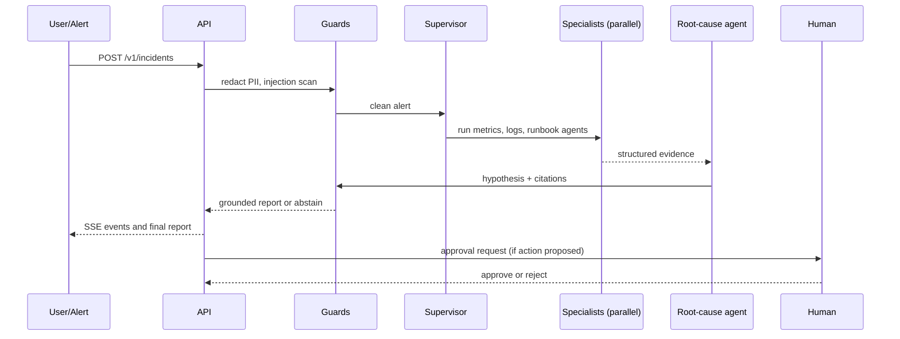

# System Architecture: IncidentIQ

## 1. Overview

Two systems run side by side:

1. **Shop (target system):** a small e-commerce backend that produces real metrics and logs and is broken on purpose.
2. **IncidentIQ:** the investigation platform (API, agents, RAG, guardrails, evals, observability).

They connect only through Prometheus (metrics) and log files, read via MCP servers.

## 2. Component diagram

## 3. Incident sequence

## 4. Layers and responsibilities

| Layer | Responsibility |
|---|---|
| API (FastAPI) | Validation, auth, rate limit, SSE streaming, persistence |
| Guardrails | PII redaction, injection scan, groundedness, abstention, budget |
| Orchestration (LangGraph) | State machine, parallel fan-out, checkpointing, interrupts |
| Agents | Prompted LLM workers returning Pydantic outputs |
| MCP servers | Tool boundary: validation, caps, audit, untrusted-data wrapping |
| RAG | Ingest, hybrid retrieval, rerank, citations |
| LLM layer | Model router, retry and fallback, caching, cost tracking |
| Observability | Langfuse traces, Prometheus metrics, Grafana |
| Eval | Replay runner, scorers, judge, versioned results, CI gate |

## 5. Run modes

| Mode | Data source | Used for |
|---|---|---|
| live | Real Prometheus and real log files from the running shop | Demos |
| replay | Frozen scenario folders | Evals, CI, debugging (deterministic) |

Selected by `DATA_MODE=live|replay` and `SCENARIO_ID` env vars read by the MCP servers.

## 6. Key design decisions

| Decision | Rationale | Trade-off |
|---|---|---|
| Real demo shop plus replay snapshots | Real telemetry shape, deterministic evals | Extra setup time |
| Custom MCP servers | Shows protocol understanding, enforce least privilege | More code than reusing existing servers |
| Parallel specialists | Lower latency | Slightly more complex state merging |
| Structured outputs everywhere | Easy scoring, fewer parse errors | Prompt design effort |
| Human approval via LangGraph interrupt | Safe actions, resumable runs | Needs checkpointer |
| Postgres plus pgvector in one DB | Simple ops, one backup | Less scalable than a dedicated vector DB (fine at this scale) |
| Model router | Cost savings | Needs eval to confirm no quality loss |
| Local embeddings and reranker | Free, no rate limits | Needs CPU and RAM |

## 7. Failure handling

| Failure | Behavior |
|---|---|
| LLM call fails or times out | Retry with backoff, then fallback model, then abstain |
| MCP tool error | Agent records "tool unavailable" evidence, continues with others |
| Budget exceeded | Stop loop, return partial report flagged `budget_exceeded` |
| Guard flags injection | Quarantine content, continue without it, record flag |
| Approval timeout | Incident stays `awaiting_approval`; no action taken |

## 8. Scalability notes (honest scope)

The system is designed for demo scale (a few incidents per minute). For larger scale: move agent execution to a worker queue (Celery or Arq with Redis), run MCP servers as separate deployments, and move vectors to a dedicated store. These are documented as future work, not built in v1.
