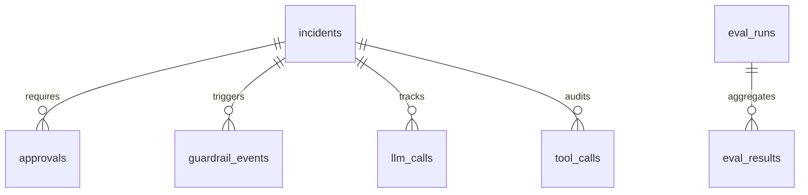

# Database Design: IncidentIQ

IncidentIQ supports a dual-engine architecture:
1. **Local Development Target:** Lightweight, zero-dependency SQLite (`sqlite:///incidentiq.db`) with native JSON column support for instant developer onboarding and offline benchmark evaluation.
2. **Production Deploy Target:** PostgreSQL 16 (via `postgresql+psycopg://`) managed through additive Alembic migrations (`alembic upgrade head`).

Migrations are strictly additive (no disruptive drops) to ensure backwards-compatibility and safe production zero-downtime rollouts.

## 1. Implemented Database Architecture & ER Diagram

The database manages both the core incident lifecycle and detailed telemetry/eval records:



### Table Inventory (Implemented in Code & Alembic Migrations)

| Table Name | Target Dialects | Primary Key | Purpose |
|---|---|---|---|
| `incidents` | SQLite & Postgres | `id` (VARCHAR 64) | Core incident lifecycle, alert metadata, status, JSON evidence, hypotheses, and execution timeline |
| `approvals` | SQLite & Postgres | `id` (VARCHAR 36 UUID) | Cryptographic capability token nonces, approval request IDs, action proposals, and human decisions |
| `guardrail_events` | SQLite & Postgres | `id` (VARCHAR 36 UUID) | Audit trail of PII redactions, prompt injection interceptions, and groundedness drop flags |
| `llm_calls` | SQLite & Postgres | `id` (VARCHAR 36 UUID) | Granular model call telemetry: model name, purpose, token usage, cost, and latency |
| `tool_calls` | SQLite & Postgres | `id` (VARCHAR 36 UUID) | MCP tool audit log: server name, tool name, arguments, output, allowlist verification status |
| `eval_runs` | SQLite & Postgres | `id` (VARCHAR 36 UUID) | IncidentBench evaluation run summary metrics (accuracy, cost, latency, split, repeats) |
| `eval_results` | SQLite & Postgres | `id` (VARCHAR 36 UUID) | Per-scenario evaluation scores and hypothesis outcomes within an evaluation run |


## 2. Schema (DDL)

```sql
CREATE EXTENSION IF NOT EXISTS vector;
CREATE EXTENSION IF NOT EXISTS pgcrypto;

-- ===== Core incident data =====
CREATE TABLE incidents (
  id            UUID PRIMARY KEY DEFAULT gen_random_uuid(),
  source        TEXT NOT NULL CHECK (source IN ('live','replay','eval')),
  scenario_id   TEXT,                       -- set in replay/eval
  service       TEXT NOT NULL,
  symptom       TEXT NOT NULL,
  window_start  TIMESTAMPTZ NOT NULL,
  window_end    TIMESTAMPTZ NOT NULL,
  raw_alert     JSONB NOT NULL,             -- after PII redaction
  status        TEXT NOT NULL DEFAULT 'queued'
                CHECK (status IN ('queued','running','awaiting_approval','completed','abstained','failed','budget_exceeded')),
  cost_usd      NUMERIC(10,6) DEFAULT 0,
  latency_ms    INTEGER,
  code_version  TEXT,                       -- git sha
  created_at    TIMESTAMPTZ DEFAULT now(),
  completed_at  TIMESTAMPTZ
);
CREATE INDEX idx_incidents_status ON incidents(status, created_at DESC);
CREATE INDEX idx_incidents_scenario ON incidents(scenario_id);

CREATE TABLE agent_runs (
  id            UUID PRIMARY KEY DEFAULT gen_random_uuid(),
  incident_id   UUID NOT NULL REFERENCES incidents(id) ON DELETE CASCADE,
  agent_name    TEXT NOT NULL,              -- supervisor, metrics, logs, runbook, root_cause, guard
  status        TEXT NOT NULL,              -- running, ok, error, skipped
  started_at    TIMESTAMPTZ DEFAULT now(),
  finished_at   TIMESTAMPTZ,
  output        JSONB,                      -- structured agent output
  langfuse_trace_id TEXT
);
CREATE INDEX idx_agent_runs_incident ON agent_runs(incident_id);

CREATE TABLE evidence (
  id            TEXT PRIMARY KEY,           -- e.g. 'ev_metric_003', stable citation id
  incident_id   UUID NOT NULL REFERENCES incidents(id) ON DELETE CASCADE,
  kind          TEXT NOT NULL CHECK (kind IN ('metric','log','runbook','postmortem')),
  source_ref    TEXT NOT NULL,              -- tool call id, log line range, or kb chunk id
  summary       TEXT NOT NULL,
  data          JSONB,                      -- compact raw evidence (capped)
  created_by    TEXT NOT NULL,              -- agent name
  created_at    TIMESTAMPTZ DEFAULT now()
);
CREATE INDEX idx_evidence_incident ON evidence(incident_id);

CREATE TABLE hypotheses (
  id            UUID PRIMARY KEY DEFAULT gen_random_uuid(),
  incident_id   UUID UNIQUE NOT NULL REFERENCES incidents(id) ON DELETE CASCADE,
  category      TEXT,                       -- e.g. db_pool_exhaustion; NULL if abstained
  service       TEXT,
  confidence    REAL CHECK (confidence BETWEEN 0 AND 1),
  reasoning     TEXT,
  evidence_ids  TEXT[] NOT NULL DEFAULT '{}',
  suggested_action JSONB,
  abstained     BOOLEAN NOT NULL DEFAULT FALSE,
  abstain_reason TEXT,
  groundedness  REAL,                       -- guard score
  created_at    TIMESTAMPTZ DEFAULT now()
);

CREATE TABLE approvals (
  id            UUID PRIMARY KEY DEFAULT gen_random_uuid(),
  incident_id   UUID NOT NULL REFERENCES incidents(id) ON DELETE CASCADE,
  action        JSONB NOT NULL,             -- proposed remediation (dry-run)
  decision      TEXT CHECK (decision IN ('approved','rejected','expired')),
  decided_by    TEXT,
  token_hash    TEXT,                       -- hash of approval token issued to remediation MCP
  requested_at  TIMESTAMPTZ DEFAULT now(),
  decided_at    TIMESTAMPTZ
);

-- ===== LLM and tool telemetry =====
CREATE TABLE llm_calls (
  id            UUID PRIMARY KEY DEFAULT gen_random_uuid(),
  agent_run_id  UUID REFERENCES agent_runs(id) ON DELETE CASCADE,
  incident_id   UUID REFERENCES incidents(id) ON DELETE CASCADE,
  model         TEXT NOT NULL,
  purpose       TEXT,                       -- route, summarize, reason, judge
  prompt_tokens INTEGER, completion_tokens INTEGER,
  cost_usd      NUMERIC(10,6),
  latency_ms    INTEGER,
  cache_hit     BOOLEAN DEFAULT FALSE,
  error         TEXT,
  created_at    TIMESTAMPTZ DEFAULT now()
);
CREATE INDEX idx_llm_calls_incident ON llm_calls(incident_id);

CREATE TABLE tool_calls (
  id            UUID PRIMARY KEY DEFAULT gen_random_uuid(),
  agent_run_id  UUID REFERENCES agent_runs(id) ON DELETE CASCADE,
  incident_id   UUID REFERENCES incidents(id) ON DELETE CASCADE,
  server        TEXT NOT NULL,              -- metrics, logs, remediation
  tool          TEXT NOT NULL,
  arguments     JSONB,
  result_size   INTEGER,
  allowed       BOOLEAN NOT NULL,           -- allow-list decision
  error         TEXT,
  latency_ms    INTEGER,
  created_at    TIMESTAMPTZ DEFAULT now()
);

CREATE TABLE guardrail_events (
  id            UUID PRIMARY KEY DEFAULT gen_random_uuid(),
  incident_id   UUID REFERENCES incidents(id) ON DELETE CASCADE,
  stage         TEXT NOT NULL,              -- input, tool_output, output
  type          TEXT NOT NULL,              -- pii, injection, ungrounded, budget, forbidden_tool
  action        TEXT NOT NULL,              -- redacted, quarantined, removed, blocked, abstained
  detail        JSONB,
  created_at    TIMESTAMPTZ DEFAULT now()
);

-- ===== Knowledge base / RAG =====
CREATE TABLE kb_documents (
  id            TEXT PRIMARY KEY,           -- e.g. 'runbook_db_pool'
  doc_type      TEXT NOT NULL CHECK (doc_type IN ('runbook','postmortem')),
  title         TEXT NOT NULL,
  path          TEXT NOT NULL,
  tags          TEXT[] DEFAULT '{}',
  content_hash  TEXT NOT NULL,              -- re-ingest only on change
  updated_at    TIMESTAMPTZ DEFAULT now()
);

CREATE TABLE kb_chunks (
  id            TEXT PRIMARY KEY,           -- e.g. 'runbook_db_pool#3'
  document_id   TEXT NOT NULL REFERENCES kb_documents(id) ON DELETE CASCADE,
  section_title TEXT,
  content       TEXT NOT NULL,
  token_count   INTEGER,
  embedding     vector(384),                -- bge-small = 384 dims; use 768 for bge-base
  tsv           tsvector GENERATED ALWAYS AS (to_tsvector('english', content)) STORED
);
CREATE INDEX idx_chunks_vec ON kb_chunks USING hnsw (embedding vector_cosine_ops);
CREATE INDEX idx_chunks_tsv ON kb_chunks USING gin (tsv);

-- ===== Evaluation =====
CREATE TABLE scenarios (
  id            TEXT PRIMARY KEY,           -- '003_db_pool_exhaustion'
  fault_type    TEXT NOT NULL,
  difficulty    TEXT CHECK (difficulty IN ('easy','medium','hard','ambiguous')),
  label         JSONB NOT NULL,             -- ground truth (see label.json)
  path          TEXT NOT NULL
);

CREATE TABLE eval_runs (
  id            UUID PRIMARY KEY DEFAULT gen_random_uuid(),
  name          TEXT NOT NULL,              -- 'v1-baseline', 'v2-optimized'
  code_version  TEXT NOT NULL,
  config        JSONB NOT NULL,             -- models, thresholds, router settings
  repeats       INTEGER DEFAULT 3,
  started_at    TIMESTAMPTZ DEFAULT now(),
  finished_at   TIMESTAMPTZ,
  summary       JSONB                       -- aggregate metrics
);

CREATE TABLE eval_results (
  id            UUID PRIMARY KEY DEFAULT gen_random_uuid(),
  eval_run_id   UUID NOT NULL REFERENCES eval_runs(id) ON DELETE CASCADE,
  scenario_id   TEXT NOT NULL REFERENCES scenarios(id),
  repeat_idx    INTEGER NOT NULL,
  incident_id   UUID REFERENCES incidents(id),
  correct       BOOLEAN,
  evidence_recall REAL,
  groundedness  REAL,
  tool_use_ok   BOOLEAN,
  abstain_ok    BOOLEAN,
  cost_usd      NUMERIC(10,6),
  latency_ms    INTEGER,
  notes         TEXT
);
CREATE INDEX idx_eval_results_run ON eval_results(eval_run_id);

-- ===== Red team =====
CREATE TABLE redteam_cases (
  id            TEXT PRIMARY KEY,           -- 'rt_007'
  category      TEXT NOT NULL,              -- poisoned_log, poisoned_runbook, prompt_leak, forbidden_tool, indirect
  payload       JSONB NOT NULL,
  expected      TEXT NOT NULL               -- 'blocked'
);

CREATE TABLE redteam_runs (
  id            UUID PRIMARY KEY DEFAULT gen_random_uuid(),
  name          TEXT NOT NULL,
  code_version  TEXT NOT NULL,
  started_at    TIMESTAMPTZ DEFAULT now()
);

CREATE TABLE redteam_results (
  id            UUID PRIMARY KEY DEFAULT gen_random_uuid(),
  redteam_run_id UUID NOT NULL REFERENCES redteam_runs(id) ON DELETE CASCADE,
  case_id       TEXT NOT NULL REFERENCES redteam_cases(id),
  outcome       TEXT NOT NULL CHECK (outcome IN ('blocked','partial','succeeded')),
  evidence      TEXT
);

-- ===== Audit =====
CREATE TABLE audit_log (
  id            BIGSERIAL PRIMARY KEY,
  actor         TEXT NOT NULL,              -- agent or user
  event         TEXT NOT NULL,
  detail        JSONB,
  created_at    TIMESTAMPTZ DEFAULT now()
);
```

## 3. Hybrid retrieval query (pattern)

```sql
-- vector candidates
SELECT id, 1 - (embedding <=> :qvec) AS score
FROM kb_chunks ORDER BY embedding <=> :qvec LIMIT 20;

-- keyword candidates
SELECT id, ts_rank(tsv, websearch_to_tsquery('english', :q)) AS score
FROM kb_chunks WHERE tsv @@ websearch_to_tsquery('english', :q)
ORDER BY score DESC LIMIT 20;
```

Merge both lists with reciprocal rank fusion in Python, rerank the top 20 with the cross-encoder, return the top 5.

## 4. Data notes

- Scenario raw data (metrics, logs) stays in files under `scenarios/`, not in the DB. Only labels and metadata are stored.
- `raw_alert` is stored after PII redaction.
- Evidence rows hold compact, capped data to avoid bloating the DB.
- Retention: demo data can be truncated freely; keep `eval_runs` and `redteam_runs` permanently for the results history.
- Embedding dimension must match the model: 384 for bge-small, 768 for bge-base. Changing it requires re-embedding and altering the column.
