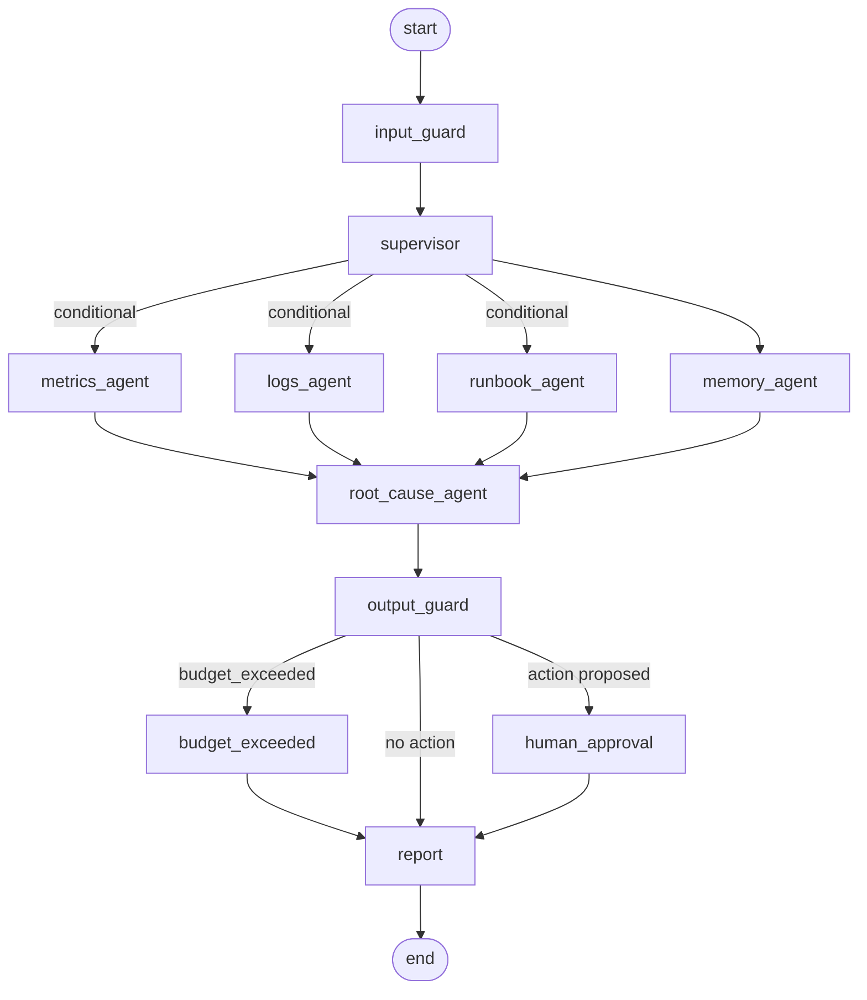

# Agent and MCP Design: IncidentIQ

## 1. LangGraph state

```python
from typing import TypedDict, Annotated, Literal
import operator
from pydantic import BaseModel

class Alert(BaseModel):
    service: str
    symptom: str
    window_start: str
    window_end: str

class Evidence(BaseModel):
    id: str                      # stable citation id, e.g. "ev_log_004", "ev_mem_inc_123"
    kind: Literal["metric", "log", "runbook", "postmortem", "memory"]
    summary: str
    source_ref: str              # tool call id, kb chunk id, or db incident ref
    data: dict | None = None     # compact, capped

class Action(BaseModel):
    type: Literal["restart_service", "rollback_deploy", "review_config", "scale_up", "none"]
    target: str
    detail: str

class Hypothesis(BaseModel):
    category: str | None = None  # None if abstained
    service: str | None = None
    confidence: float = 0.0      # 0..1
    reasoning: str
    evidence_ids: list[str]
    suggested_action: Action | None = None
    abstained: bool = False
    abstain_reason: str | None = None
    is_fallback: bool = False

class IncidentState(TypedDict, total=False):
    incident_id: str
    scenario_id: str | None
    alert: Alert
    plan: list[str]                                   # specialists to run
    evidence: Annotated[list[Evidence], operator.add] # parallel nodes append
    hypothesis: Hypothesis | None
    guardrail_flags: Annotated[list[str], operator.add]
    approval: dict | None
    cost_usd: Annotated[float, operator.add]
    steps: Annotated[int, operator.add]
    error: str | None
```

## 2. Graph



Implementation notes:
- Parallel fan-out: `supervisor_node` runs deterministically (`cost_usd: 0.0`, no LLM call), emits `plan = ["metrics", "logs", "runbook"]` via `route_specialist_fanout`, and fans out concurrently with the unconditional edge to `memory_agent` (4 parallel branches merging `evidence`, `guardrail_flags`, `cost_usd`, and `steps` via `operator.add`).
- Human approval gating: `build_incident_graph().compile()` runs without a LangGraph checkpointer or native `interrupt()`. Instead, `human_approval_node` creates a single-use HMAC capability token (`incidentiq/security/tokens.py`), writes `approvals` to SQLite, stores `approval` (hashed token only), and ends the graph run as `awaiting_approval`; `POST /v1/incidents/{id}/approval` later consumes/re-issues the token and executes the dry-run MCP remediation tool.
- Per-call Scenario Isolation: `scenario_id` is stored on `IncidentState` and passed as a validated per-call argument through `mcp_client.py` to `metrics_server` and `logs_server` (no process-wide `os.environ["SCENARIO_ID"]` mutation; `SCENARIO_ID` env var acts only as server fallback). `metrics_server` also verifies `metrics.json["service"]` matches the requested service.
- Knowledge Retrieval (BM25): `runbook_agent` uses in-memory Okapi BM25 lexical ranking with Jaccard overlap and service metadata boosting (`incidentiq/rag/engine.py`) and scans retrieved chunks for prompt injection before synthesis; dense vector embeddings and cross-encoders are deferred (Planned / Future work).
- Episodic Agent Memory (`incidentiq/rag/memory.py`, `ENABLE_AGENT_MEMORY=true`): `memory_agent` runs in parallel with the specialists, queries SQLite only for human-verified past incidents (`incident_feedback` or decided `approvals`), enforces a lexical relevance floor (`MIN_LEXICAL_MEMORY_SCORE = 1.5` excluding service boost), scrubs PII and quarantines prompt injections, and preserves an anti-confirmation-bias rule in `root_cause_agent_node` (live `"metric"` or `"log"` telemetry anomalies are still required before diagnosing).
- Static Typing Note: CI runs `mypy .`, while `IncidentState` stays a `TypedDict` for LangGraph runtime dict operations (`graph.py` carries `# pyrefly: ignore[bad-specialization]` as an IDE hint due to upstream `TypedDictLikeV1 | TypedDictLikeV2` protocol checks).
- `steps` and `cost_usd` are checked after `output_guard` via `route_after_output_guard` against `MAX_AGENT_STEPS` and `INCIDENT_BUDGET_USD`; exceeding limits routes to `budget_exceeded` and forces abstention (`ABSTAIN_THRESHOLD` and `GROUND_THRESHOLD` enforced in `output_guard_node`).
- Prompt Leakage Guard: `output_guard_node` runs both citation groundedness verification and `GuardrailManager.scan_prompt_leakage` before finalizing output.

## 3. Nodes in detail

| Node | Input | Output | Model tier | Tools |
|---|---|---|---|---|
| `input_guard` | raw alert | clean alert, flags | Rules (regex PII + injection scan) | none |
| `supervisor` | alert | `plan` | None (deterministic, zero cost) | none |
| `metrics_agent` | alert, `scenario_id` | `Evidence[]` | Deterministic MCP caller | metrics MCP only |
| `logs_agent` | alert, `scenario_id` | `Evidence[]` | Deterministic MCP caller | logs MCP only |
| `runbook_agent` | alert | `Evidence[]` (`runbook`/`postmortem`) | Rules (BM25 + Jaccard) | BM25 RAG retriever |
| `memory_agent` | alert, incident/scenario exclusions | `Evidence[]` (`ev_mem_*`) | Rules (BM25 + Jaccard over SQLite) | SQLite verified episodes |
| `root_cause_agent` | all evidence | `Hypothesis` | `MODEL_STRONG` (LiteLLM) or deterministic fallback | none (reasons over evidence only) |
| `output_guard` | hypothesis, evidence | verified hypothesis or abstain | Rules (citation ratio + leakage scan) | none |
| `human_approval` | proposed action | `approval` record + HMAC token | None | none (tool invoked later via `/approval`) |

## 4. Prompt contracts (implemented)

The root-cause system prompt and structured JSON schema instructions are currently defined inline inside `_call_llm_for_diagnosis` in `incidentiq/agents/nodes.py` (`incidentiq/agents/prompts/` directory exists and external `*.md` prompt templates are Planned / Future work).

Inline diagnosis rules enforced in `nodes.py`:
1. Cite only explicit `evidence_ids` present in collected telemetry/KB/memory lists.
2. Live telemetry (`metric` or `log` anomalies) must corroborate any episodic memory match.
3. Set `abstained=true` if telemetry is normal, contradictory, or insufficient, or if `confidence < ABSTAIN_THRESHOLD`.
4. Return strict JSON matching the `Hypothesis` contract (`category`, `service`, `confidence`, `reasoning`, `evidence_ids`, `suggested_action`, `abstained`, `abstain_reason`).

## 5. Tool allow-lists (enforced in code, not in prompts)

| Agent key (`AGENT_TOOL_ALLOWLISTS`) | Allowed MCP / internal tools |
|---|---|
| `metrics_agent` | `metrics`: `query_metric`, `list_metrics`, `detect_anomaly` |
| `logs_agent` | `logs`: `search_logs`, `get_error_clusters`, `get_log_context` |
| `runbook_agent` | `search_knowledge_base`, `retrieve_runbooks` (internal BM25 retriever) |
| `root_cause_agent` | none |
| `remediation` (invoked after `/approval` only) | `remediation`: `restart_service`, `rollback_deploy`, `scale_up`, `review_config` (dry-run) |

`call_mcp_tool` in `incidentiq/agents/mcp_client.py` intercepts every MCP call, verifies `is_tool_allowed_for_agent(agent_name, tool_name)`, records the outcome in `tool_calls.allowed`, and raises `PermissionError` on violation.

## 6. MCP servers

All servers use `mcp.server.mcpserver.MCPServer` (`mcp==2.3.0`), serve Streamable HTTP (`streamable_http_app()`) in Docker Compose (`9101`–`9103`), and also support direct in-process dispatch when `MCP_MODE!=http`.

### 6.1 metrics_server

| Tool | Args | Returns |
|---|---|---|
| `list_metrics` | `service` | `ALLOWED_METRICS` list |
| `query_metric` | `service, metric, minutes (1..180), scenario_id=""` | summary (`min, max, mean, count`) plus up to 60 downsampled points |
| `detect_anomaly` | `service, metric, minutes (1..180), scenario_id=""` | `anomalous`, `z_score`, `baseline_mean`, `recent_mean`, `severity` |

Allowed metrics: `error_rate`, `latency_p95`, `request_rate`, `memory_mb`, `db_pool_in_use`, `cache_hit_rate`.

### 6.2 logs_server

| Tool | Args | Returns |
|---|---|---|
| `search_logs` | `service, query="", level="", minutes=30, limit=50 (max 50), scenario_id=""` | matching lines (truncated to 300 chars), wrapped in `<untrusted_data>` |
| `get_error_clusters` | `service, minutes=30, scenario_id=""` | top 10 normalized error clusters wrapped in `<untrusted_data>` |
| `get_log_context` | `service, line_id="", before=5 (max 20), after=5 (max 20), scenario_id=""` | surrounding lines wrapped in `<untrusted_data>` |

### 6.3 remediation_server (dry-run only)

| Implemented MCP Tool | Args | Action.type | Legacy design name |
|---|---|---|---|
| `restart_service` | `service, token, incident_id=""` | `restart_service` | `propose_restart` (deprecated doc name) |
| `rollback_deploy` | `service, target_version, token, incident_id=""` | `rollback_deploy` | `propose_rollback` (deprecated doc name) |
| `scale_up` | `service, replicas, token, incident_id=""` | `scale_up` | — |
| `review_config` | `service, parameter, proposed_value, token, incident_id=""` | `review_config` | — |

Requires a valid, single-use, 15-minute TTL HMAC capability `token` (`verify_capability_token`) bound to `action`, `target`, and `incident_id`. Without it the call returns `UNAUTHORIZED_ACTION`.

### 6.4 Shared server rules

- Validation helpers (`mcp_servers/validation.py`): strict `ALLOWED_SERVICES`, `ALLOWED_METRICS`, traversal-safe `validate_scenario_id`, window/limit/context clamping, PromQL service sanitization.
- Read-only telemetry queries for metrics and logs.
- Every log response is wrapped via `wrap_untrusted`: `<untrusted_data>\n...\n</untrusted_data>`.
- Every MCP call is persisted to `tool_calls`.
- Modes: `DATA_MODE=live` (Prometheus HTTP API and `logs/*.log` files) or `replay` (reads `scenarios/<id>/` via `scenario_id` arg or `SCENARIO_ID` fallback).

## 7. LLM layer (Implemented) & Planned / Future work

- **Implemented (`incidentiq/agents/nodes.py`):** Calls `litellm.completion` for `root_cause_synthesis` (`MODEL_STRONG`) with `num_retries=2`, optional Langfuse callback attachment, token/cost logging to `llm_calls`, and automatic deterministic rule-based fallback (`is_fallback=true`) when no API key is configured or the provider fails.
- **Planned / Future work (not yet split into `incidentiq/llm/`):** dedicated `llm/router.py` (`MODEL_SMALL` routing & `MODEL_JUDGE` scoring), Redis exact-match cache (`llm/cache.py`), standalone `llm/cost.py` pricing table, external versioned `incidentiq/agents/prompts/*.md` files, and native LangGraph checkpointing / `interrupt()` resume.

## 8. Confidence, groundedness, and abstention policy

- **Zero telemetry -> mandatory abstain (`0.20`):** When neither `metrics_agent` nor `logs_agent` finds anomalous telemetry (`telemetry_evidence == []`), `root_cause_agent_node` forces `abstained=True` (`confidence=0.20`), preventing KB chunks or memory episodes alone from claiming an outage.
- **Citation-validity groundedness:** `GuardrailManager.verify_groundedness` checks that each ID in `hypothesis.evidence_ids` exists in gathered `state["evidence"]` (citation validity, not per-claim LLM judging), strips unknown IDs, and forces `abstained=True` (clearing `suggested_action`) when `0` valid citations remain, `valid / original < GROUND_THRESHOLD` (default `0.85`), or `confidence < ABSTAIN_THRESHOLD` (default `0.50`).
- **Cost accounting:** `supervisor_node` and `memory_agent_node` add `$0.0`; `metrics_agent_node` (`$0.001`), `logs_agent_node` (`$0.001`), and `runbook_agent_node` (`$0.0005`) emit fixed specialist allowances, and `root_cause_agent_node` computes actual token cost via `litellm.completion_cost()`/`cost_per_token()` for live LLM calls (or falls back to `$0.002` synthetic when deterministic fallback/abstain runs without an LLM call).
- **Planned / Future work:** Multi-kind confidence capping (reducing confidence when `< 2` independent evidence kinds agree or conflict) and per-claim LLM faithfulness judging.
