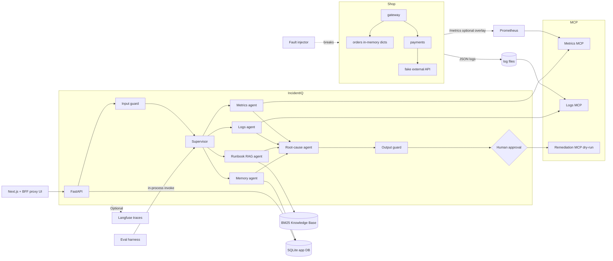
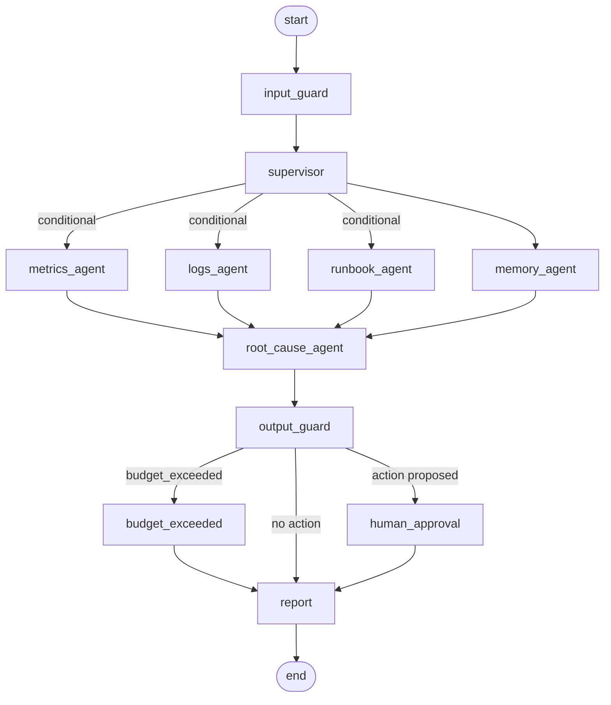

# IncidentIQ — Comprehensive System Reference

Code-verified reference mirroring the current repository implementation across backend, agents, MCP servers, RAG, database, UI, evaluation, and deployment. For the concise onboarding README see [../README.md](../README.md), and for module specs see [00_README.md](00_README.md)–[11_ROADMAP_14_DAY.md](11_ROADMAP_14_DAY.md).

---

## 1. Architecture & Component Overview

Two systems run side by side: **Shop** (4 FastAPI services emitting `/metrics` and `structlog` JSON logs, with `orders` backed by in-memory dicts) and **IncidentIQ** (FastAPI API, LangGraph agents, FastMCP servers, regex guardrails, in-memory BM25 RAG + SQLite episodic memory, evals, and Next.js 16 UI).

- **In-process evaluation:** `evals/run_evals.py` invokes `incident_graph.invoke(...)` directly in-process rather than calling FastAPI over HTTP.
- **Live fault injection scope:** `faults/injector.py` supports `--fault db_pool`, `slow_query`, `dependency_timeout`, and `reset` targeting `shop/orders` and `shop/fake_external`; other categories (`memory_leak`, `cache_failure`, `bad_deploy_config`) exist as recorded scenarios in `scenarios/`.

---

## 2. Agent Graph, Groundedness, Approval & Cost Accounting

- **Deterministic supervisor & parallel fan-out:** `supervisor_node` makes zero LLM calls (`cost_usd: 0.0`) and sets `plan = ["metrics", "logs", "runbook"]`. Conditional edges plus the unconditional `memory_agent` edge run 4 parallel branches merging `evidence`, `guardrail_flags`, `cost_usd`, and `steps` via `operator.add`.
- **Confidence & groundedness:** When neither `metrics_agent` nor `logs_agent` discovers anomalous telemetry (`telemetry_evidence == []`), `root_cause_agent_node` forces abstention (`confidence = 0.20`). `GuardrailManager.verify_groundedness` checks **citation validity** (that every `evidence_ids` entry exists in collected `state["evidence"]`, not per-claim LLM judging) and abstains when `0` citations remain, `valid / original < GROUND_THRESHOLD` (`0.85`), or `confidence < ABSTAIN_THRESHOLD` (`0.50`). Multi-kind confidence capping and per-claim LLM judging are **Planned / Future work**.
- **Human approval gating:** `build_incident_graph().compile()` compiles **without** a LangGraph checkpointer or `interrupt()`. `human_approval_node` issues a single-use HMAC capability token (15m TTL), persists `approvals` and `status = "awaiting_approval"` in SQLite, and `POST /v1/incidents/{id}/approval` consumes/re-issues the token to execute dry-run `remediation_server` tools (`restart_service`, `rollback_deploy`, `scale_up`, `review_config`).
- **Cost accounting (`cost_usd`):** `supervisor_node` and `memory_agent_node` add `$0.0`; `metrics_agent_node` (`$0.001`), `logs_agent_node` (`$0.001`), and `runbook_agent_node` (`$0.0005`) emit fixed specialist step allowances. `root_cause_agent_node` computes live LLM token costs via `litellm.completion_cost()` / `litellm.cost_per_token()` in `nodes.py` (falling back to `$0.002` synthetic only on fallback/abstain paths without an LLM call). Only `evals/results/v2-live.json` (`$0.0033` mean) reflects post-`9ba61ac` token cost calculation; `v1-baseline.json` and `v2-optimized.json` predate commit `9ba61ac`'s synthetic-cost refresh.

---

## 3. Retrieval, Database, API & UI

- **KB & Memory Retrieval (`incidentiq/rag/`):** Markdown files under `knowledge/` are split on `## ` headings and scored with Okapi BM25 + Jaccard + `+2.5` service boost (`engine.py`). Episodic memory (`memory.py`) queries verified SQLite incidents above `MIN_LEXICAL_MEMORY_SCORE = 1.5`, scans for PII/injection, and cannot substantiate an incident without live metric or log evidence.
- **Database (`incidentiq/db/models.py`):** 8 Alembic-managed tables (`incidents`, `approvals`, `llm_calls`, `tool_calls`, `guardrail_events`, `eval_runs`, `eval_results`, `incident_feedback`) on single-worker SQLite (`WORKERS=1`).
- **API (`incidentiq/api/main.py`):** `/health`, `/healthz`, `/readyz` (DB + optional HTTP MCP TCP check), `GET /v1/scenarios`, `GET/POST /v1/incidents`, `GET /v1/incidents/{id}`, `GET /v1/incidents/{id}/stream` (SSE), `POST /v1/incidents/{id}/approval` (`approve` / `reject` input -> `approved` / `rejected` DB decision -> `remediation_executed` / `rejected_by_human` status), `POST /v1/incidents/{id}/feedback`, `GET /v1/evals`, `GET /v1/redteam`.
- **Observability:** Optional Langfuse traces and `deploy/docker-compose.monitoring.yml` starting Prometheus (`127.0.0.1:9090`) scraping `shop/*` `/metrics`. IncidentIQ API `iiq_*` `/metrics` and Grafana are **Planned / Future work**.
- **UI (`ui/`):** Next.js 16 + React 19 + TypeScript + Tailwind CSS v4 + Lucide Icons + Motion (`ui/package.json`; no charting library installed) across 6 routes (`/`, `/incidents`, `/incidents/[id]`, `/evaluation`, `/security`, `/shop`) and BFF proxy `/api/v1/[...path]`.

---

## 4. Benchmarks (`evals/results/`)

- **IncidentBench-mini:** 8 scenarios (**3 easy, 3 medium, 2 ambiguous, 0 hard**; `6 dev` / `2 held_out` in `evals/splits.json`). Because the benchmark has only 8 scenarios, percentages are indicative regression checks rather than statistically strong proof.
- **`v2-live.json` (`groq/openai/gpt-oss-120b`, 3 repeats, 24 runs, post-`9ba61ac`):** Accuracy `100.0% (±0.0%)`, Citation Groundedness `100.0%`, Abstention `100.0%`, Action Safety `100.0%`, Mean Cost `$0.0033` (`±$0.0007`), Latency p50/p95 `1468.7ms` / `3058.1ms`.
- **`retrieval_summary.json`:** Hit@3 `100.0%` (`20/20`), MRR `0.975`.
- **`redteam_summary.json`:** `20/20` blocked (`100.0%`, deterministic pattern guards are probabilistic and do not guarantee immunity).
