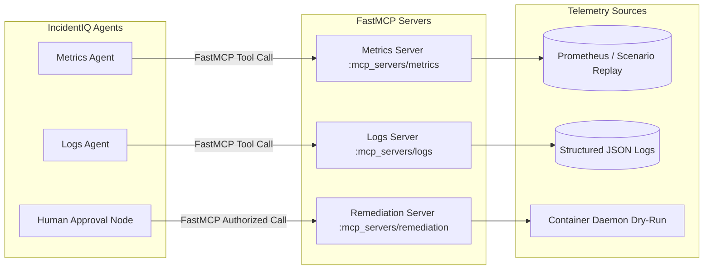

# Model Context Protocol (FastMCP) Servers 🔌

This directory contains isolated **Model Context Protocol (MCP)** tool servers powering IncidentIQ's specialist agents. Each server exposes strongly-typed interfaces adhering to the FastMCP specification, enforcing least-privilege security boundaries and quarantine envelopes.

---

## Architecture Overview



---

## 1. Metrics Server (`mcp_servers/metrics/server.py`)

Provides downsampled metric time-series and real-time statistical anomaly detection.

### Exposed Tools
* `list_metrics(service: str) -> list[str]`
  * Returns allowed metrics for the requested microservice: `error_rate`, `latency_p95`, `request_rate`, `memory_mb`, `db_pool_in_use`, `cache_hit_rate`.
* `query_metric(service: str, metric: str, minutes: int = 30) -> dict[str, Any]`
  * Queries a rolling time window.
  * Calculates summary statistics (`min`, `max`, `mean`, `count`, `p95`).
  * Computes **Z-Score Anomaly Detection**:
    $$Z = \frac{x_i - \mu}{\sigma}$$
    Applies a variance floor ($\sigma \ge 0.05$) to prevent false alarms on near-constant time series.
  * Operates in live mode against `PROMETHEUS_URL` or frozen replay mode (`DATA_MODE=replay`) via `scenarios/<scenario_id>/metrics.json`.

---

## 2. Logs Server (`mcp_servers/logs/server.py`)

Aggregates structured JSON logs, clusters repetitive error patterns, and enforces quarantine envelopes against indirect prompt injection.

### Exposed Tools
* `search_logs(service: str, query: str = "", limit: int = 50) -> list[dict[str, Any]]`
  * Searches logs filtered by service name and keyword.
  * Automatically wraps all log outputs inside untrusted quarantine boundaries:
    ```html
    <untrusted_data>
    {"timestamp": "...", "level": "error", "message": "Connection refused"}
    </untrusted_data>
    ```
* `cluster_logs(service: str, minutes: int = 30) -> list[dict[str, Any]]`
  * Deduplicates repetitive stack traces into canonical signature clusters with occurrence frequencies.
  * Masks dynamic tokens (GUIDs, transaction IDs, memory addresses) to produce clean cluster templates.

---

## 3. Remediation Server (`mcp_servers/remediation/server.py`)

Enforces cryptographic human-in-the-loop authorization for all mutating actions.

### Exposed Tools
* `restart_service(service: str, token: str) -> dict[str, Any]`
  * Simulates container restart.
  * **Strict Prerequisite:** Requires a valid single-use token starting with `appr_` (e.g., `appr_4b92f01a8e23`).
  * Executes in dry-run mode, returning a signed receipt without modifying production infrastructure.
* `rollback_deploy(service: str, target_version: str, token: str) -> dict[str, Any]`
  * Simulates deployment rollback to a designated commit SHA or image tag.
  * Requires valid authorization token verification.

---

## Security Guarantees

1. **Least-Privilege Allowlist:** Metrics and logs servers are strictly read-only.
2. **Untrusted Boundary Isolation:** Logs collected from target services are treated as untrusted user input, neutralizing prompt injection payloads before they reach the LLM supervisor.
3. **No Direct Execution:** The remediation server rejects any tool call missing a valid cryptographic approval capability token.
