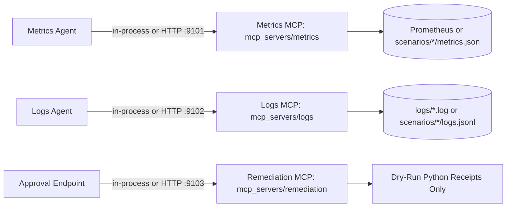

# MCP (Model Context Protocol) Servers

This folder holds three **FastMCP** tool servers used by IncidentIQ agents.
MCP is a standard JSON/HTTP protocol that lets AI agents call fixed tools safely.
Each server enforces strict input checks and least-privilege access rules.

---

## Architecture

---

## 1. Metrics Server (`mcp_servers/metrics/server.py`)

Reads metric time-series data and detects statistical spikes.

### Exposed Tools
* `list_metrics(service: str) -> list[str]`
  * Returns allowed metric names when `service` is valid: `error_rate`, `latency_p95`, `request_rate`, `memory_mb`, `db_pool_in_use`, and `cache_hit_rate`.
* `query_metric(service: str, metric: str, minutes: int = 30, scenario_id: str = "") -> dict[str, Any]`
  * Reads up to 180 minutes (`clamp_window`) and returns summary stats (`min`, `max`, `mean`, `count`) plus the last 60 points.
  * When `DATA_MODE=replay`, it reads `scenarios/<scenario_id>/metrics.json` and checks that the file's `service` matches `service`.
  * When `DATA_MODE=live`, it queries `{PROMETHEUS_URL}/api/v1/query_range` (default `http://localhost:9090`).
* `detect_anomaly(service: str, metric: str, minutes: int = 30, scenario_id: str = "") -> dict[str, Any]`
  * Splits points into baseline and recent halves and computes a **Z-score**:
    `z_score = abs(recent_mean - base_mean) / std_floor`
  * Applies a standard-deviation floor (`std_floor = max(base_std, base_mean * 0.05, 0.5)`) so flat baselines do not trigger false alarms.

---

## 2. Logs Server (`mcp_servers/logs/server.py`)

Searches structured JSON logs and groups repeated errors while isolating untrusted text.

### Exposed Tools
* `search_logs(service: str, query: str = "", level: str = "", minutes: int = 30, limit: int = 50, scenario_id: str = "") -> list[dict[str, Any]]`
  * Filters logs from `scenarios/<scenario_id>/logs.jsonl` (`replay`) or `logs/<service>.log` (`live`).
  * Wraps every returned `msg` inside `<untrusted_data>...</untrusted_data>` tags (truncated to 300 chars).
* `get_error_clusters(service: str, minutes: int = 30, scenario_id: str = "") -> list[dict[str, Any]]`
  * Groups `error`, `fatal`, and `critical` messages after replacing UUIDs with `<UUID>` and numbers with `<N>`.
  * Returns the top 10 clusters wrapped in `<untrusted_data>` tags.
* `get_log_context(service: str, line_id: str = "", before: int = 5, after: int = 5, scenario_id: str = "") -> dict[str, Any]`
  * Returns up to 20 lines before and 20 lines after a matching log entry, each wrapped in `<untrusted_data>`.

---

## 3. Remediation Server (`mcp_servers/remediation/server.py`)

Validates single-use cryptographic approval tokens and returns dry-run receipts.
The server fails fast on startup if `APPROVAL_TOKEN_SECRET` is unset or empty.

### Exposed Tools
* `restart_service(service: str, token: str, incident_id: str = "") -> dict[str, Any]`
* `rollback_deploy(service: str, target_version: str, token: str, incident_id: str = "") -> dict[str, Any]`
* `scale_up(service: str, replicas: int, token: str, incident_id: str = "") -> dict[str, Any]`
* `review_config(service: str, parameter: str, proposed_value: str, token: str, incident_id: str = "") -> dict[str, Any]`

Every tool checks two things before returning `"status": "dry_run_success"`:
1. `service` must be in `ALLOWED_SERVICES` (`orders`, `payments`, `gateway`, `fake-external`, `fake_external`, `redis`).
2. `token` (`cap_<payload>.<sig>`) must pass HMAC-SHA256 verification for the expected `action`, `target`, and `incident_id`, within its 15-minute TTL (`900s`), and must not have been consumed already.

None of these tools touch real Docker containers, Kubernetes clusters, or config files.

---

## 4. Transport Modes & Allowlists (`incidentiq/agents/mcp_client.py`)

* **In-process mode (default):** Calls tool Python functions directly when `MCP_MODE` is unset or not `"http"`.
* **HTTP mode (`MCP_MODE=http`):** Calls Streamable HTTP endpoints (`/mcp`) at:
  * `MCP_METRICS_URL` (default `http://mcp-metrics:9101/mcp`, port `9101`)
  * `MCP_LOGS_URL` (default `http://mcp-logs:9102/mcp`, port `9102`)
  * `MCP_REMEDIATION_URL` (default `http://mcp-remediation:9103/mcp`, port `9103`)
* **Per-agent allowlists (`incidentiq/agents/tool_registry.py`):**
  * `metrics_agent`: `query_metric`, `list_metrics`, `detect_anomaly`
  * `logs_agent`: `search_logs`, `get_error_clusters`, `get_log_context`
  * `runbook_agent`: `search_knowledge_base`, `retrieve_runbooks`
  * `root_cause_agent`: none (`set()`)
  * `remediation`: `restart_service`, `rollback_deploy`, `scale_up`, `review_config`
