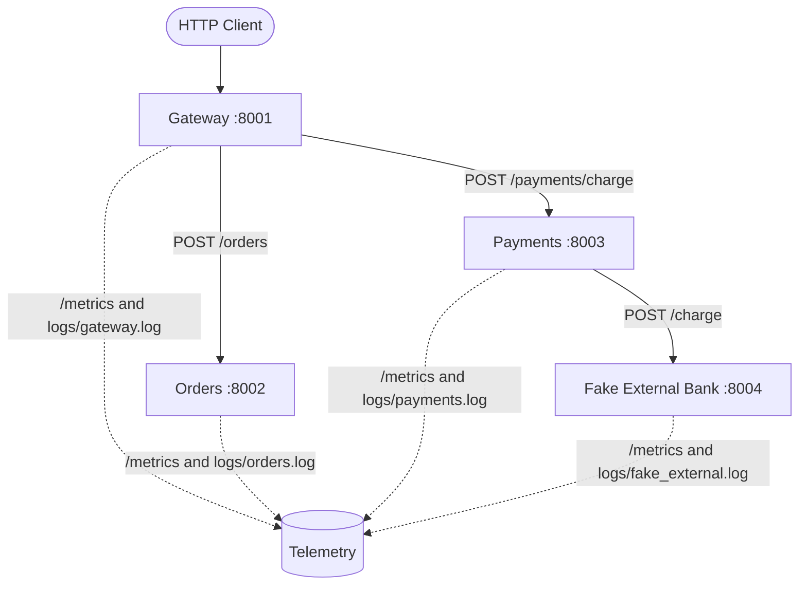

# Demo Shop Microservices (`shop/`)

This folder holds four small FastAPI services that act as a sample e-commerce app.
They emit Prometheus metrics and structured JSON logs for live-mode testing.
In `deploy/docker-compose.yml`, all four services stay on the internal Docker network.

---

## 1. Services and Ports



* **`shop/gateway` (port `8001`):** Forwards `/checkout` requests to Orders and Payments, and `/orders/{order_id}` to Orders. It does not check JWT tokens or rate limits.
* **`shop/orders` (port `8002`):** Stores orders and cached items in in-memory Python dicts (`ORDERS_DB` and `ORDERS_CACHE`), not real Postgres or Redis servers.
* **`shop/payments` (port `8003`):** Calls `fake_external` (`/charge`) with a configurable timeout (`PAYMENTS_TIMEOUT_SEC`, default `5.0`s).
* **`shop/fake_external` (port `8004`):** Simulates a downstream payment API with configurable delay and failure rate.

---

## 2. Metrics and Logs (`shop/common/telemetry.py`)

Each service uses `setup_telemetry(app, service_name)` to expose `/metrics` and write non-blocking JSON logs:
* **Queue-based file logs:** A `QueueHandler` and per-service `QueueListener` write JSON lines to `logs/<service>.log` and `logs/shop.log`.
* **Log fields:** `ts`, `event`, `level`, `service`, and middleware context (`request_id`, `endpoint`, `method`, `status`, `duration_ms`).
* **Prometheus gauges, counters, and histograms:**
  * `shop_requests_total`
  * `shop_request_duration_seconds`
  * `shop_errors_total`
  * `shop_memory_mb`
  * `shop_db_pool_in_use`
  * `shop_cache_hit_rate`

---

## 3. Fault Injection Endpoints

Only `fake_external` and `orders` expose chaos routes in code (`gateway` and `payments` do not):

```bash
# 1. Inject 5s delay and 30% failures on fake_external (port 8004)
curl -X POST http://localhost:8004/chaos \
  -H "Content-Type: application/json" \
  -d '{"delay_sec": 5.0, "failure_rate": 0.3}'

# 2. Force DB connection pool exhaustion on orders (port 8002)
curl -X POST "http://localhost:8002/chaos/pool_exhaust?enabled=true"

# 3. Simulate slow DB queries (3.5s sleep) on orders (port 8002)
curl -X POST "http://localhost:8002/chaos/slow_query?enabled=true"
```
