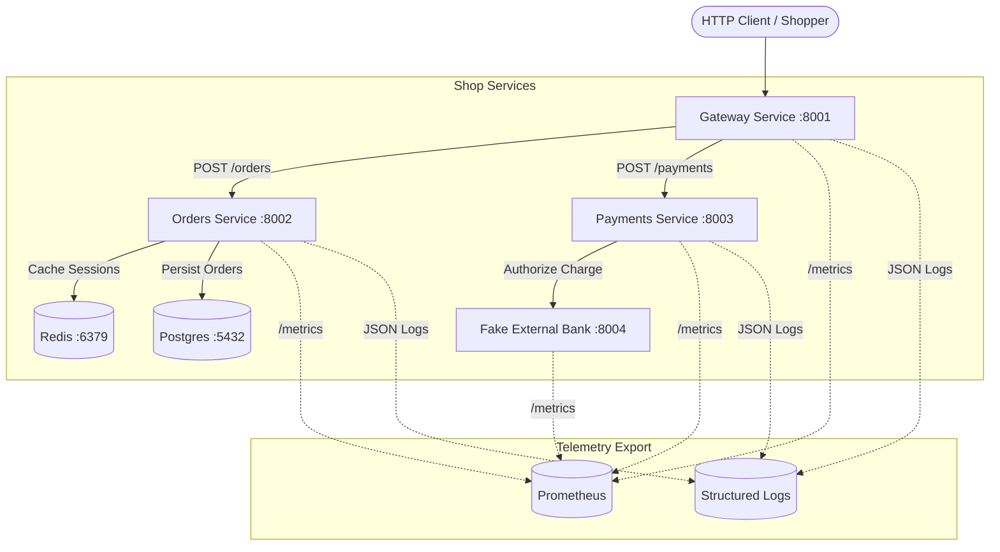

# Target E-Commerce Microservices & Chaos Lab 🛒

This directory contains the simulated distributed microservices suite (`shop/`) that generates production telemetry, structured JSON logs, Prometheus metrics, and chaos failure modes for IncidentIQ.

---

## 1. Services Architecture



### Microservices Port Allocations
* **`shop/gateway` (Port 8001):** API gateway handling ingress, authentication tokens, rate-limiting, and request forwarding.
* **`shop/orders` (Port 8002):** Checkout, order creation, order state lifecycle, PostgreSQL connection pool, and Redis caching.
* **`shop/payments` (Port 8003):** Payment processing pipeline, idempotency tokens, and upstream banking calls.
* **`shop/fake_external` (Port 8004):** Third-party banking / payment gateway with configurable artificial latency and error rates.

---

## 2. Telemetry & Instrumentation (`shop/common/telemetry.py`)

Every microservice uses standard structured logging (`structlog`) and Prometheus client instrumentation:

* **Non-Blocking Asynchronous Logging:** Implemented with Python's standard `logging.handlers.QueueHandler` and a background `QueueListener` worker thread, ensuring file disk writes never block FastAPI's async event loop.
* **Prometheus Metrics:**
  * `shop_requests_total`: Request counter partitioned by `service`, `method`, `endpoint`, and `status`.
  * `shop_request_duration_seconds`: Histogram measuring latency buckets ($10\text{ms}$ to $10\text{s}$).
  * `shop_errors_total`: Error counter partitioned by `error_type`.
  * `shop_memory_mb`: Gauge tracking resident memory usage (RSS).
  * `shop_db_pool_in_use`: Active PostgreSQL database connection count.
  * `shop_cache_hit_rate`: Ratio of successful cache hits to misses.
* **Structured Logs:**
  * JSON logs containing `timestamp`, `level`, `service`, `request_id`, and contextual metadata.

---

## 3. Chaos Injection & Failure Scenarios

Each service exposes a `/chaos` endpoint allowing instant live fault injection:

```bash
# Inject 5.0 second artificial network latency into the external payment bank
curl -X POST http://localhost:8004/chaos \
  -H "Content-Type: application/json" \
  -d '{"delay_sec": 5.0, "failure_rate": 0.3}'

# Trigger database connection pool exhaustion in orders service
curl -X POST http://localhost:8002/chaos \
  -H "Content-Type: application/json" \
  -d '{"pool_exhaustion": true}'

# Simulate a progressive memory leak in the API gateway
curl -X POST http://localhost:8001/chaos \
  -H "Content-Type: application/json" \
  -d '{"leak_mb_per_req": 25.0}'
```

These live failure modes match the frozen scenarios evaluated in `evals/`.
